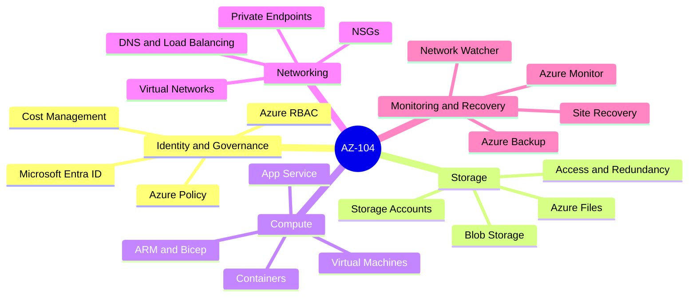
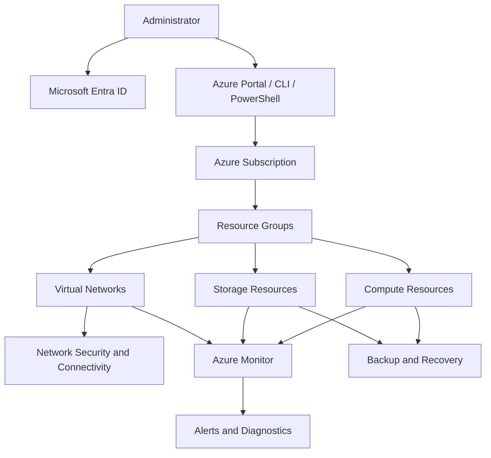
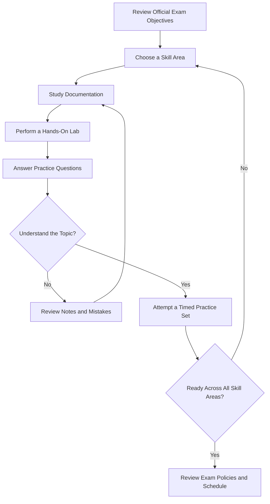
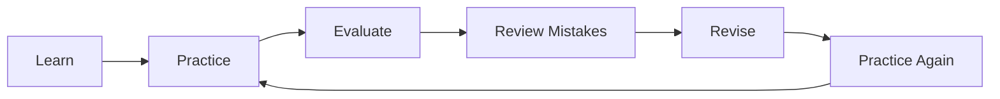

 AZ-104: Microsoft Azure Administrator — Study Guide and Practice Questions

Prepare for the Microsoft Azure Administrator (AZ-104) exam with a structured study roadmap, hands-on Azure practice, exam-objective reviews, and practice questions. This repository brings key preparation topics and useful learning resources together in one place.

Explore additional IT certification preparation resources at [CertsGate](https://certsgate.com/).

> Important Always check Microsoft's official AZ-104 study guide before your exam. Microsoft can update exam objectives, skills, and policies over time.

---

 Table of Contents

- [Overview](#overview)
- [Who Should Use This Guide?](#who-should-use-this-guide)
- [AZ-104 Exam Objectives](#az-104-exam-objectives)
- [Azure Administration Mind Map](#azure-administration-mind-map)
- [Azure Environment Architecture](#azure-environment-architecture)
- [Exam Preparation Workflow](#exam-preparation-workflow)
- [Recommended Study Cycle](#recommended-study-cycle)
- [Step-by-Step Study Roadmap](#step-by-step-study-roadmap)
- [Hands-On Lab Checklist](#hands-on-lab-checklist)
- [Practice Questions and Mock Tests](#practice-questions-and-mock-tests)
- [Common Preparation Mistakes](#common-preparation-mistakes)
- [Frequently Asked Questions](#frequently-asked-questions)
- [Official Study Resources](#official-study-resources)
- [About CertsGate](#about-certsgate)
- [Disclaimer](#disclaimer)

---

 Overview

The AZ-104 exam is associated with the **Microsoft Certified: Azure Administrator Associate** certification. It focuses on administering, configuring, securing, and monitoring Microsoft Azure environments.

Preparation involves understanding Azure services and learning how to perform common administrative tasks through the Azure portal, Azure CLI, PowerShell, and infrastructure-as-code tools.

| Item | Details |
|---|---|
| Exam code | AZ-104 |
| Exam name | Microsoft Azure Administrator |
| Certification | Microsoft Certified: Azure Administrator Associate |
| Level | Intermediate |
| Main platform | Microsoft Azure |
| Core focus | Identity, governance, storage, compute, networking, monitoring, and recovery |
| Official study guide | [Microsoft Learn — AZ-104](https://learn.microsoft.com/en-us/credentials/certifications/resources/study-guides/az-104) |

Refer to the official Microsoft certification page for the latest exam availability, scheduling information, pricing, and policies.

---

 Who Should Use This Guide?

This repository is useful for:

- IT professionals developing Azure administration skills.
- Cloud administrators preparing for the AZ-104 exam.
- System administrators moving into cloud infrastructure.
- Networking professionals learning Azure networking.
- Students seeking structured Microsoft Azure certification preparation.
- Candidates who want to combine theory, labs, and practice questions.

A basic understanding of operating systems, networking, servers, and virtualization is useful. Familiarity with Microsoft Entra ID, Azure CLI, PowerShell, and Azure Resource Manager or Bicep can also support preparation.

---

 AZ-104 Exam Objectives

Microsoft's study guide lists five major skill areas. The percentages below reflect the official objective ranges in the guide available as of April 17, 2026.

| Skill area | Official exam weight |
|---|---:|
| Manage Azure identities and governance | 20–25% |
| Implement and manage storage | 15–20% |
| Deploy and manage Azure compute resources | 20–25% |
| Implement and manage virtual networking | 15–20% |
| Monitor and maintain Azure resources | 10–15% |

1. Manage Azure Identities and Governance

Focus on:

- Microsoft Entra users and groups.
- User properties, licenses, external users, and self-service password reset.
- Azure role-based access control (Azure RBAC).
- Role assignments and access scopes.
- Azure Policy and resource locks.
- Resource groups, subscriptions, management groups, and tags.
- Budgets, cost alerts, and Azure Advisor recommendations.

 2. Implement and Manage Storage

Study:

- Storage accounts and redundancy options.
- Storage access keys and shared access signatures (SAS).
- Storage firewalls and virtual network restrictions.
- Identity-based access for Azure Files.
- Azure Blob Storage containers and access tiers.
- Azure Files shares.
- Blob versioning, snapshots, soft delete, and lifecycle management.
- Azure Storage Explorer and AzCopy.

 3. Deploy and Manage Azure Compute Resources

Review:

- Azure Resource Manager templates and Bicep files.
- Virtual machine creation, sizing, disks, and encryption.
- Availability sets, availability zones, and virtual machine scale sets.
- Azure Container Registry.
- Azure Container Instances and Azure Container Apps.
- Azure App Service plans, applications, scaling, TLS, backups, and deployment slots.
- Moving resources between supported scopes or regions.

 4. Implement and Manage Virtual Networking

Learn to configure and troubleshoot:

- Virtual networks and subnets.
- Virtual network peering.
- Public IP addresses and user-defined routes.
- Network security groups (NSGs) and application security groups.
- Azure Bastion.
- Service endpoints and private endpoints.
- Azure DNS.
- Internal and public load balancers.
- Network connectivity and load-balancing issues.

 5. Monitor and Maintain Azure Resources

Concentrate on:

- Azure Monitor metrics and logs.
- Log queries and analysis.
- Alert rules, action groups, and alert processing rules.
- Azure Monitor Insights.
- Network Watcher and Connection Monitor.
- Recovery Services vaults and Azure Backup vaults.
- Backup policies, restore operations, and backup monitoring.
- Azure Site Recovery and failover to a secondary region.

**Objective reminder:** Use Microsoft's official study guide to confirm the latest measured skills before planning your final revision.

---

Azure Administration Mind Map

Use this map to organize revision notes and identify areas that need more practice.

---

 Azure Environment Architecture

The following is a conceptual architecture for studying common Azure administration responsibilities. It is not a required exam deployment.

### Architecture concepts to understand

- Identity:** Who can sign in and what they can access.
- Governance:** How resources are organized, restricted, tagged, and managed for cost.
- Compute:** How workloads are deployed, scaled, and maintained.
- Storage:** How data is stored, protected, and accessed.
-Networking:** How Azure resources communicate securely.
- Monitoring and recovery:** How administrators detect problems and recover supported resources.

---

 Exam Preparation Workflow

Use this decision loop to make study sessions more effective.

The goal is not just to remember definitions. Practice explaining why a particular Azure configuration is appropriate and what changes when requirements differ.

---

 Recommended Study Cycle

Repeat this cycle for each exam objective.

A missed practice question should lead to a clear explanation of the underlying concept, followed by another question or lab that checks the same skill.

---

 Step-by-Step Study Roadmap

This is a suggested four-week study plan, not an official Microsoft timetable. Adjust it to your existing experience and available time.

| Week | Main focus | Practical work |
|---|---|---|
| Week 1 | Identity and governance | Users, groups, RBAC, policies, resource locks, and budgets |
| Week 2 | Storage and compute | Storage accounts, Blob Storage, Azure Files, VMs, containers, and App Service |
| Week 3 | Virtual networking | VNets, subnets, NSGs, peering, DNS, private endpoints, and load balancing |
| Week 4 | Monitoring, recovery, and revision | Azure Monitor, alerts, backup, Site Recovery concepts, and timed practice |

 Suggested daily routine

1. Review one or two related exam objectives.
2. Read the relevant Microsoft Learn material.
3. Configure the service in a suitable Azure lab environment.
4. Write short notes describing the configuration and its purpose.
5. Complete practice questions on the topic.
6. Review incorrect answers and revisit weak areas.

---

 Hands-On Lab Checklist

Use the checklist to track practical experience.

- [ ] Create and manage Microsoft Entra users and groups.
- [ ] Assign Azure RBAC roles at appropriate scopes.
- [ ] Configure Azure Policy, tags, and resource locks.
- [ ] Review subscription budgets and cost alerts.
- [ ] Create a storage account and compare redundancy options.
- [ ] Configure a Blob Storage container and access controls.
- [ ] Create an Azure Files share.
- [ ] Deploy a virtual machine and manage its disks and size.
- [ ] Review an ARM template or Bicep deployment.
- [ ] Deploy a container or an App Service application.
- [ ] Configure a virtual network and subnet.
- [ ] Create NSG rules and evaluate their effective behavior.
- [ ] Review private endpoint and service endpoint use cases.
- [ ] Configure an Azure Monitor alert.
- [ ] Explore backup and recovery configuration options.

Only perform labs in an authorized subscription. Review available quotas, permissions, and pricing before creating resources, and remove lab resources when they are no longer needed.

---

 Practice Questions and Mock Tests

Practice questions can help you identify gaps in your understanding and become more comfortable applying Azure concepts to scenarios.

Use a repeatable process:

1. Answer a question without immediately checking the explanation.
2. Identify the relevant AZ-104 objective.
3. Explain why the correct option fits the scenario.
4. Understand why the alternative options do not fit.
5. Revisit the topic in Microsoft Learn.
6. Try another question covering the same skill.

For additional certification preparation material and practice resources, visit [CertsGate](https://certsgate.com/).

Illustrative practice question

Scenario: An organization needs to allow an administrator to manage virtual machines in a resource group without granting broad access to the entire subscription.

Which approach should the administrator investigate?

A. Assign an appropriate Azure RBAC role at the resource-group scope.  
B. Give the administrator unrestricted subscription-level access.  
C. Disable network security groups.  
D. Change the storage account redundancy setting.

**Answer:** A.

Explanation: Azure RBAC role assignments can be scoped to a resource group. The assigned role should provide only the permissions required for the task. Always validate the exact permissions and scope against the scenario.

This is an original illustrative practice question, not an official Microsoft exam question.*

---

 Common Preparation Mistakes

Avoid these common study habits:

- Memorizing definitions without practicing configurations.
- Ignoring the official exam objective percentages.
- Studying from an outdated skills outline.
- Confusing Azure RBAC with Microsoft Entra directory roles.
- Overlooking the differences between service endpoints and private endpoints.
- Forgetting storage access controls and redundancy options.
- Practicing only familiar topics while ignoring weaker areas.
- Assuming a practice-test score guarantees an exam result.
- Creating Azure resources without checking their cost or cleaning them up.

A strong preparation routine combines official documentation, hands-on practice, and thoughtful review of mistakes.

---

 Frequently Asked Questions

 What is the AZ-104 exam?

AZ-104 is the Microsoft Azure Administrator exam associated with the Azure Administrator Associate certification.

 What topics should I study for AZ-104?

The five main skill areas are identity and governance, storage, compute resources, virtual networking, and monitoring and maintenance.

 Is hands-on practice important?

Yes. Practical experience helps you understand how Azure services behave and how administrative configurations affect access, connectivity, cost, and recovery.

Should I use the latest study guide?

Yes. Exam objectives can change. Check the official Microsoft Learn study guide and its skills-measured date before starting or finalizing your preparation.

 Where can I find additional practice resources?

Start with Microsoft's official learning paths and practice assessment. You can also explore third-party preparation resources at [CertsGate](https://certsgate.com/).

 Does completing this guide guarantee that I will pass?

No. Results depend on your knowledge, practical skills, preparation, and performance on the actual exam.

---

 Official Study Resources

Use official Microsoft resources as the primary reference for exam requirements and Azure behavior.

- [AZ-104 Official Study Guide](https://learn.microsoft.com/en-us/credentials/certifications/resources/study-guides/az-104)
- [Microsoft Certified: Azure Administrator Associate](https://learn.microsoft.com/en-us/credentials/certifications/azure-administrator/)
- [Microsoft Learn](https://learn.microsoft.com/)
- [Azure Documentation](https://learn.microsoft.com/en-us/azure/)
- [Azure Architecture Center](https://learn.microsoft.com/en-us/azure/architecture/)
- [Azure Pricing Calculator](https://azure.microsoft.com/en-us/pricing/calculator/)
- [Microsoft Learn Practice Assessments](https://learn.microsoft.com/en-us/credentials/certifications/practice-assessments-for-microsoft-certifications)

Check the official certification page for current scheduling, exam delivery, pricing, and certification renewal information.

---

 About CertsGate

[CertsGate](https://certsgate.com/) provides IT certification preparation resources for learners exploring technology exams and professional development paths.

Candidates can use the website alongside official documentation, structured study plans, practical exercises, and their own revision notes.

Explore: [https://certsgate.com/](https://certsgate.com/)

